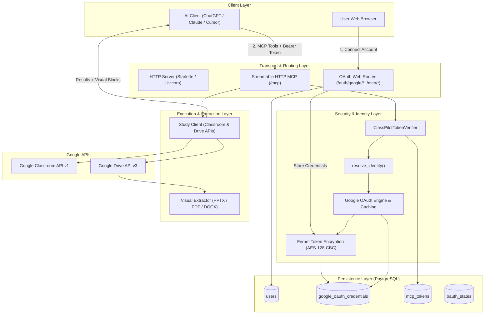
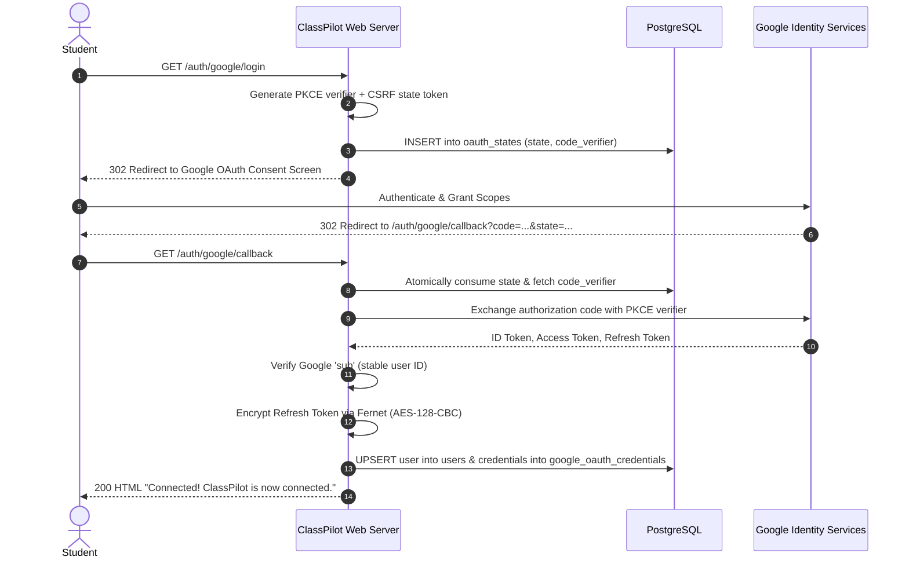
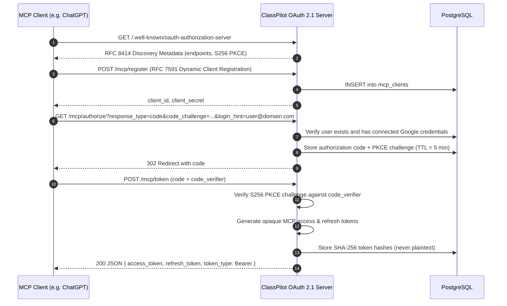
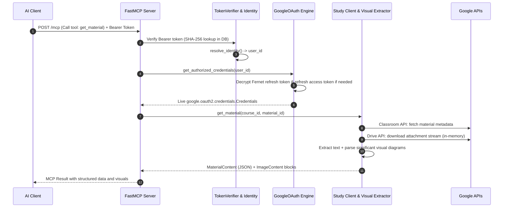

# ClassPilot AI — Technical Architecture

ClassPilot AI is a production-grade [Model Context Protocol (MCP)](https://modelcontextprotocol.io) server that enables AI clients (such as ChatGPT, Claude, and Cursor) to securely query Google Classroom courses, modules, announcements, and course materials, with deep text and visual extraction.

---

## 1. System Topology & Dual-OAuth Architecture

A core architectural principle of ClassPilot AI is the **strict separation between Google authentication and MCP client authentication**. These two authorization boundaries operate independently and are never conflated:

```
┌─────────────────────────────────┐
│     AI Client / Assistant       │
│  (ChatGPT / Claude / Cursor)    │
└────────────────┬────────────────┘
                 │ 1. Bearer <ClassPilot MCP Token> (OAuth 2.1 + PKCE)
                 ▼
┌────────────────────────────────────────────────────────┐
│             ClassPilot AI Application                   │
│                                                        │
│  ┌──────────────────────┐    ┌──────────────────────┐  │
│  │   FastMCP Server     │    │   OAuth 2.1 Server   │  │
│  │   (Streamable HTTP)  │    │   (/mcp/authorize)   │  │
│  └──────────┬───────────┘    └──────────▲───────────┘  │
│             │                           │              │
│             ▼                           │              │
│  ┌──────────────────────────────────────┴───────────┐  │
│  │  Identity Seam: resolve_identity()               │  │
│  │  - Maps MCP Bearer token hash to users.id        │  │
│  │  - Fails closed if token is invalid or expired   │  │
│  └──────────────────┬───────────────────────────────┘  │
│                     │                                  │
│                     ▼                                  │
│  ┌──────────────────────────────────────────────────┐  │
│  │  Credential Engine: get_authorized_credentials() │  │
│  │  - Decrypts at-rest Google refresh token         │  │
│  │  - Automatically refreshes access token if due   │  │
│  └──────────────────┬───────────────────────────────┘  │
└─────────────────────┼──────────────────────────────────┘
                      │
                      │ 2. Authenticated Google API Request
                      ▼
┌────────────────────────────────────────────────────────┐
│               Google Cloud Platform                    │
│                                                        │
│   ┌─────────────────────┐    ┌─────────────────────┐   │
│   │ Google Classroom API│    │  Google Drive API   │   │
│   │ (Courses/Materials) │    │  (Files/Export/Doc) │   │
│   └─────────────────────┘    └─────────────────────┘   │
└────────────────────────────────────────────────────────┘
```

### Why Dual OAuth?
1. **Zero Credential Leakage**: An AI client (e.g., ChatGPT) never receives, sees, or stores Google OAuth access or refresh tokens. It receives only an opaque ClassPilot-issued Bearer token.
2. **Independent Revocation**: A student can revoke an AI client's access without invalidating their Google connection, or revoke Google access to immediately neutralize all connected AI sessions.
3. **Multi-Tenant Security**: Identity is resolved server-side from request headers. The calling model cannot forge or specify a target user ID.

---

## 2. Component Architecture



---

## 3. End-to-End Sequence Workflows

### Flow A: Google Account Linking (User Onboarding)
Before an MCP client can access Classroom resources, the user establishes a link between their Google account and ClassPilot AI:



### Flow B: MCP Client OAuth 2.1 Authorization
When ChatGPT, Claude, or Cursor connects to ClassPilot AI:



### Flow C: Tool Execution & Identity Threading
When an AI client calls one of the six MCP tools:



---

## 4. Key Security Mechanisms

### A. Custom FastMCP TokenVerifier
Rather than relying on FastMCP's generic `OAuthProxy` component (which has historically been affected by vulnerabilities such as CVE-2025-69196, CVE-2026-27124, and AIKIDO-2026-10735), ClassPilot AI implements a purpose-built `ClassPilotTokenVerifier` conforming directly to FastMCP's `RemoteAuthProvider` and `TokenVerifier` interfaces.

### B. At-Rest Token Encryption & Hashing
- **Google Refresh Tokens**: Encrypted using Fernet symmetric encryption (`cryptography.fernet.Fernet`), combining 128-bit AES in CBC mode with PKCS7 padding and HMAC-SHA256 authentication. A database dump never yields plaintext Google tokens.
- **MCP Access & Refresh Tokens**: Hashed using SHA-256 before storage in PostgreSQL (`mcp_tokens.token_hash`). Bearer tokens presented in HTTP headers are hashed on the fly for comparison.

### C. Thread-Safe In-Flight OAuth Coalescing
Modern browsers often trigger pre-fetches or speculative navigation on OAuth redirects, causing race conditions with single-use authorization codes. ClassPilot AI handles this via `_inflight_callbacks` with a `threading.Lock()` and `threading.Event()`, coalescing concurrent callback requests for the same authorization state without replay risks.

### D. Multi-Tenant Physical Data Isolation
All persistent records (`users`, `google_oauth_credentials`, `mcp_tokens`, `oauth_states`) enforce foreign key constraints anchored on verified `users.id` UUIDs. Data queries strictly filter by the authenticated user's ID, guaranteeing zero cross-tenant contamination.

### E. Ephemeral In-Memory Document Streaming
When attachments (PDFs, PPTX, DOCX, Docs) are downloaded from Google Drive, they are streamed directly into an in-memory `io.BytesIO` buffer. Extracted text and image bytes are returned in the MCP response and immediately garbage-collected. **No student files, attachments, or personal study notes are ever written to the server's disk.**
